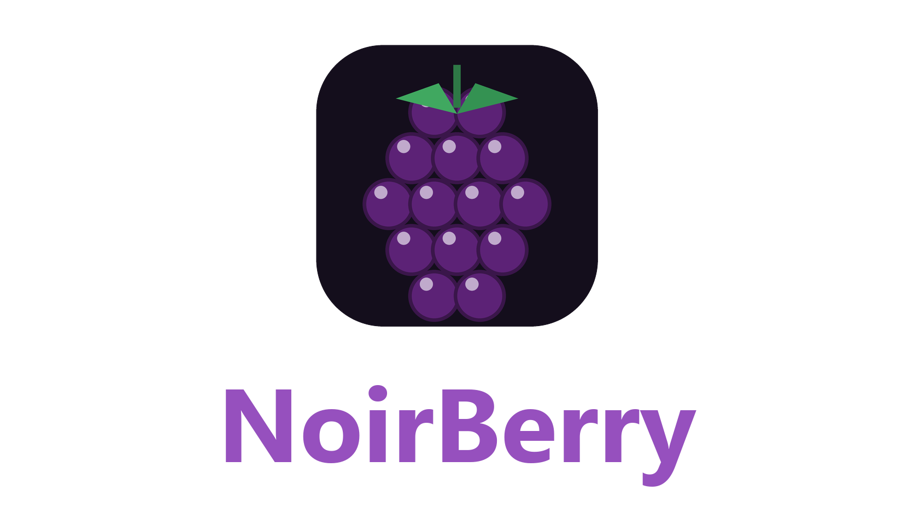

<!--
# SPDX-FileCopyrightText: Copyright 2025 Eden Emulator Project
# SPDX-License-Identifier: GPL-3.0-or-later

# SPDX-FileCopyrightText: 2018 yuzu Emulator Project
# SPDX-License-Identifier: GPL-2.0-or-later
-->

  

# NoirBerry

NoirBerry is an experimental, open-source Nintendo Switch and Switch 2 emulator written in C++. It is a research fork of [Lichii](https://github.com/zortos293/Lichii), which builds on Eglantine, Eden, yuzu and Sudachi.

This is an independent fork, not an official release of any of those projects. NoirBerry is not affiliated with Nintendo.

## Downloads and setup

Builds are published on the [releases page](https://github.com/dewayneku/NoirBerry/releases).

On Windows, extract the entire build archive and run **noirberry.exe**. Only use games and system files you have legally obtained. Games, keys and firmware are not included.

### Existing saves and settings

NoirBerry uses the same Eden/Lichii data directories and configuration keys, so existing saves, settings and shader caches are picked up as they are. Back up your saves before testing experimental builds.

## Compatibility and issue reports

Compatibility and performance vary by game, hardware and driver. Rendering errors, stutters and crashes remain possible.

When [reporting an issue](https://github.com/dewayneku/NoirBerry/issues), include the exact build, game version, CPU, GPU and driver version, relevant settings, steps to reproduce, and the log from the affected session after checking it for personal information. Do not upload game files, keys, firmware or private account information.

## Building and contributing

See the [build guide](docs/Build.md), [user documentation](docs/user/README.md) and [coding guidelines](docs/Coding.md). Some inherited documentation and internal build target names still use upstream names. The GUI build target remains `yuzu`; its output is `noirberry.exe` on Windows and `noirberry` on other desktop platforms.

## Artwork

The NoirBerry icon and logo in [dist/branding](dist/branding) are placeholders. Windows, Linux and macOS icon resources are generated from `noirberry_icon.png` by [Generate-NoirBerryIcons.ps1](tools/Generate-NoirBerryIcons.ps1).

## Credits and license

NoirBerry inherits the work of the Lichii, Eglantine, Eden, yuzu and Sudachi projects and their contributors, including Lichii's developer zortos293 and Eglantine's original developer Camille LaVey. Original copyright notices and third-party licenses are retained.

See [LICENSE.txt](LICENSE.txt) and the source files for applicable license terms.
